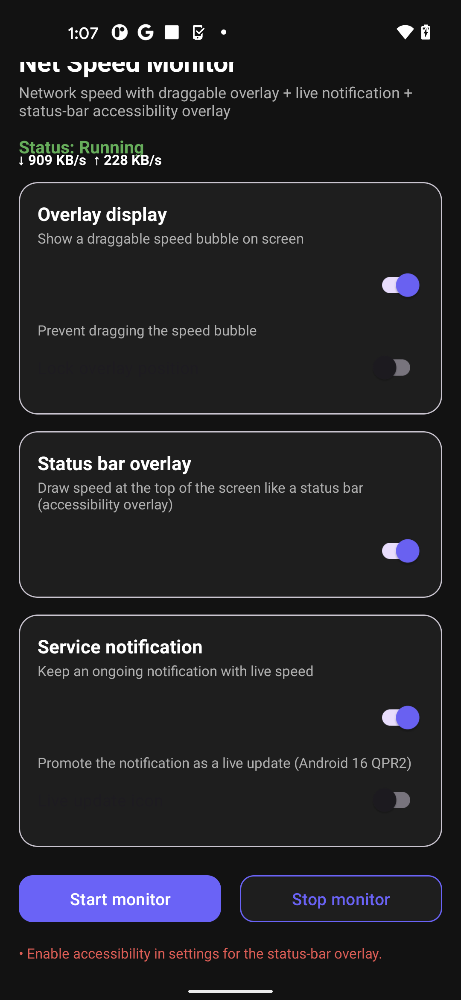
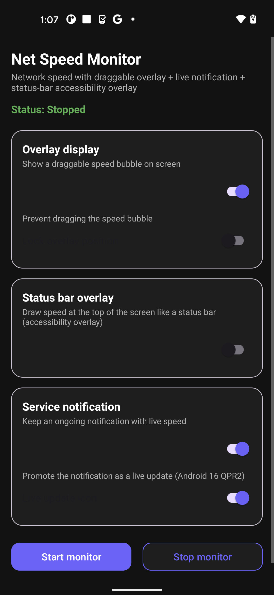
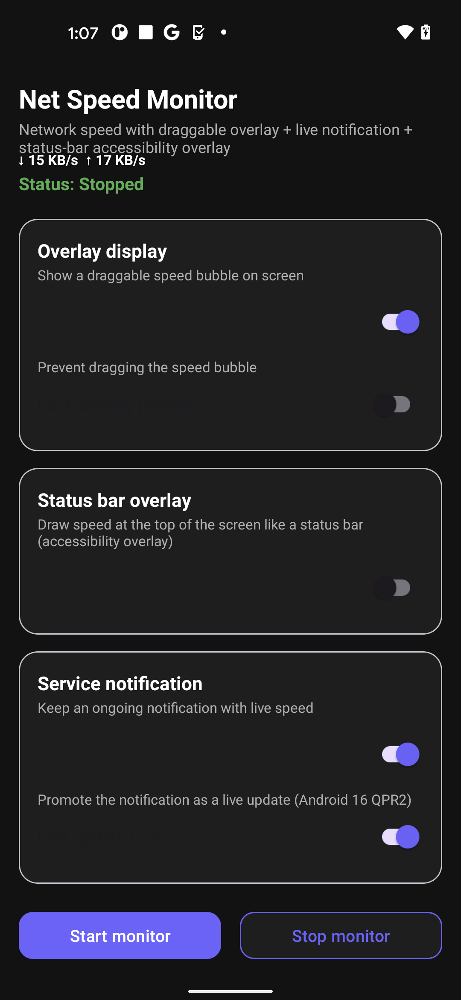
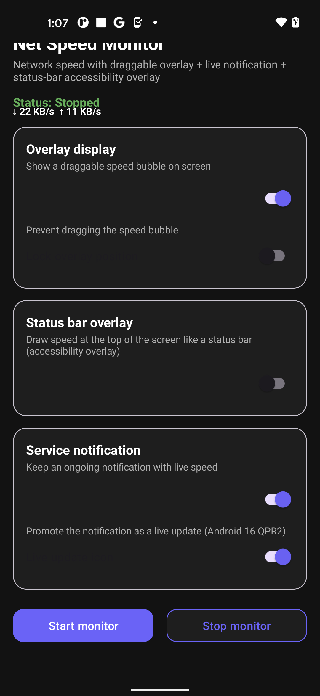
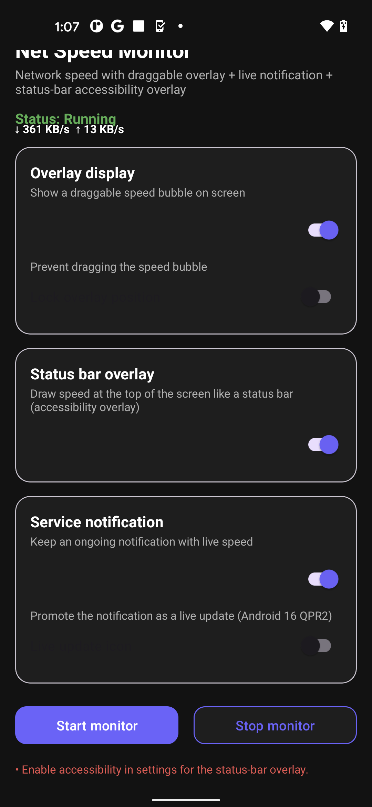
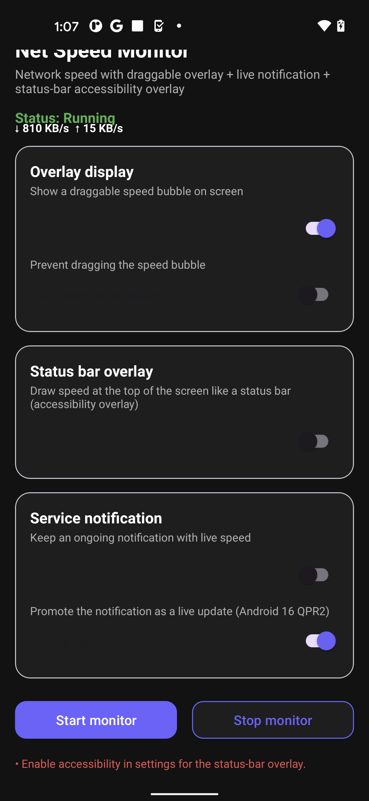
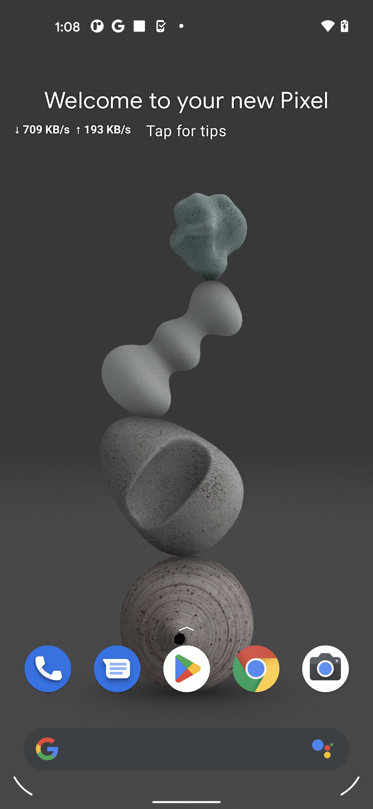

# NetSpeedMonitor — Accurate Android Network Speed Overlay

<div align="center">

-3DDC84?style=for-the-badge&logo=android&logoColor=white)


-success?style=for-the-badge&logo=firebase&logoColor=white)

[](https://wa.me/923171616345?text=Hi%20letmese%2C%20I%20am%20interested%20in%20your%20NetSpeedMonitor%20Android%20app.)

### *Precision Real-Time Floating Network Speed Meter with VPN-Duplication Filtering*

</div>

---

## 📱 Live App Screenshots (Firebase Test Lab Robo Run)

<div align="center">
  
  
  
  
</div>

<div align="center">
  
  
  
  
</div>

---

## 📖 Overview

**NetSpeedMonitor** is a lightweight, real-time internet speed indicator and floating network meter for Android. 

A common flaw in traditional speed monitors is that running a VPN causes recorded throughput to display at double the true speed (counting both the physical interface and the virtual `tun0` interface). NetSpeedMonitor solves this with **intelligent interface deduplication**, directly reading physical hardware sockets (`wlan0`, `rmnet_data0`, `eth0`) to guarantee pinpoint speed accuracy.

---

## ✨ Features & Architecture

- ⚡ **Real-Time Floating Overlay:** Movable, resizable always-on-top network speed widget with customizable typography, colors, and opacity.
- 🛡️ **VPN-Duplication Protection:** Bypasses virtual VPN loopback devices to ensure accurate speed metrics even when using WireGuard, OpenVPN, or V2Ray.
- 📊 **Status Bar & Notification HUD:** Live upload/download indicators directly in the Android notification shade.
- 🔋 **Zero Battery Drain:** Efficient polling loops with low-power wake locks and automatic screen-off suspension.
- 🔄 **Boot Persistence:** Automatically starts on device boot via `RECEIVE_BOOT_COMPLETED` background service.
- 🧪 **Cloud Verified:** Automatically crawled and regression-tested on Google Pixel physical devices via Firebase Test Lab.

---

## 🚀 Building from Source

### Prerequisites
* Android Studio (2024+)
* Android SDK 34 / 35
* JDK 17

### Build Instructions
```bash
git clone https://github.com/letmese/NetSpeedMonitor.git
cd NetSpeedMonitor

# Build debug APK
./gradlew assembleDebug
```

---

## 📦 Pre-Built Downloads

To download the ready-to-run APK (`NetSpeedMonitor-Merged-v2.0.apk`), check the releases:
* **[GitHub Releases](https://github.com/letmese/NetSpeedMonitor/releases)**

---

## 👨‍💻 Developer & Inquiries

Designed and developed by **letmese**.

* **GitHub Profile:** [@letmese](https://github.com/letmese)
* **Location:** Lahore, Pakistan (Available for mobile app contracts worldwide)
* **WhatsApp Direct:** [**+92 317 1616345**](https://wa.me/923171616345?text=Hi%20letmese%2C%20I%20am%20interested%20in%20your%20NetSpeedMonitor%20Android%20app.)

---

## 📄 License

This project is licensed under the [MIT License](LICENSE).
